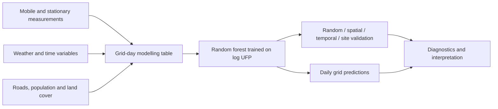

# MARKOPOLO | Geospatial data science and model validation

**Selected project work · R · environmental data engineering · random forests · spatial and temporal cross-validation**

> **Question:** How reliably can an environmental prediction model trained on measurements from particular locations and dates generalise to unseen places and future periods?

## Project at a glance

MARKOPOLO investigated the spatial and temporal variation of ultrafine particles (UFP) using mobile measurements and complementary environmental data. In this collaborative research context, I worked on a Swiss-wide modelling workflow that integrated monitoring observations with meteorology, road and traffic indicators, land cover, population and other geographic predictors. Related workflows were also developed for Denmark.

The broader project included daily prediction on a **25 m grid** and scalable processing of large geospatial datasets. This repository is **a deliberately small portfolio case study**, not a reproduction of the full research infrastructure.

### My selected contributions

- **Data integration:** R workflows combining mobile and stationary observations with daily weather, temporal features and spatial predictors.
- **Predictive modelling:** Random-forest models with log-transformed UFP, feature filtering, observation-support weighting and back-transformation.
- **Model evaluation:** Random observation holdout, spatial-cluster cross-validation, temporal holdout and held-out monitoring-site experiments.
- **Diagnostics:** Investigation of prediction bias, residual spatial dependence, weaknesses in geographical transfer and apparently misleading validation results.
- **Scalable processing:** Parquet-based, keyed predictor tables and chunked daily inference to limit memory requirements.

These are selected contributions to a **team project**, not a claim of sole authorship.

## The analytical workflow



### Why validation design matters

A model can predict random held-out rows reasonably well and still fail when applied to a genuinely new area. Repeated observations from the same locations, geographical dependence and changes over time can make naïve validation optimistic. In the research work, geographically independent validation revealed substantially weaker generalisation than random splits. Investigating that discrepancy was an important part of the analysis.

The runnable example below illustrates **four different evaluation questions**, rather than optimizing a single attractive score:

| Validation | What it tests |
|---|---|
| Random 80/20 split | Held-out observations from an already-sampled setting |
| Spatial five-fold k-means | Transfer to held-out groups of grid locations |
| Future-date holdout | Prediction at later dates |
| Leave-one-site-out demonstration | Transfer to selected, entirely unseen synthetic sites |

The code reports predictive R² (1 − SSE/SST), squared Pearson correlation, RMSE, MAE and bias separately. It also uses a training-only out-of-bag residual estimate for Duan-style retransformation of log-scale predictions.

## Run the self-contained demonstration

**Requirements:** R 4.x and the CRAN package `ranger`.

```r
install.packages("ranger")
```

From the **repository root**:

```bash
Rscript run_demo.R
```

Or in RStudio, with the repository root as the working directory:

```r
source("run_demo.R")
```

The script creates fictional grid-day observations, trains and validates small random forests, and writes a summary table, held-out predictions, diagnostic plots and session information to `outputs/`. Generated outputs are ignored by Git.

**All input observations, locations and demonstration results are synthetic.** They are not real MARKOPOLO results, and the demo is not the original production code. No institutional dataset, GIS raster, access token, model artifact or private filesystem path is required. The portfolio author has run the demo locally; output values may vary with R/package versions.

## Repository guide

| Start here | Purpose |
|---|---|
| [Case study](docs/CASE_STUDY.md) | Research problem, actual workflow, methodological decisions and limitations |
| [German overview](docs/PROJECT_OVERVIEW_DE.md) | Concise project description for a German-speaking audience |
| [Synthetic data](R/01_synthetic_data.R) | Generates fictional repeated grid-day observations |
| [Model validation](R/02_model_validation.R) | Fits RF models, creates holdouts and calculates metrics |
| [Diagnostic plots](R/03_figures.R) | Exports clearly labelled synthetic figures |
| [Run script](run_demo.R) | One-command entry point |
| [Technical notes](docs/METHOD_NOTES.md) | Mapping between the demo and research methods, plus simplifications |

## Scope and responsible sharing

This portfolio is an **independently written illustration** of selected methods from collaborative research. It contains no original measurement data, monitoring-site observations, pretrained research models, unpublished quantitative findings or production scripts. It should not be interpreted as an official project release or institutional endorsement.

The original workflow used more predictors, data sources, model settings, validation strategies and spatial-processing steps than the example here. Its complete results cannot be inferred from synthetic output. No third-party code license is granted for this sample at present.
